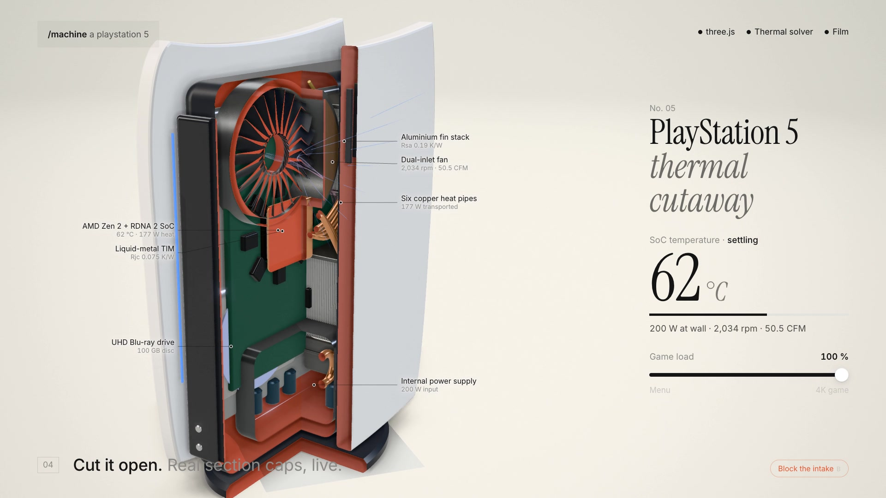

# PlayStation 5 — interactive thermal cutaway

An interactive, physics-based 3D model of the original PlayStation 5 disc edition. The simulation exposes the cooling path from the AMD SoC and liquid-metal interface through the heat pipes, fin stacks, and dual-inlet fan.

<video src="https://raw.githubusercontent.com/nikitph/playstation-5-machine/main/playstation-5.mp4" controls poster="https://raw.githubusercontent.com/nikitph/playstation-5-machine/main/poster.jpg" width="100%"></video>

_Click the image if the inline player is unavailable._

## Run the simulation

Open [`index.html`](index.html) in a modern browser. Drag to orbit the console, change the game load, and use the controls for cutaway, exploded, X-ray, labels, and blocked-intake views.

## What is modeled

- 180 physical pieces and 122,628 rendered triangles
- Game-load-dependent wall power, heat generation, fan speed, and airflow
- A lumped thermal-resistance model for SoC temperature
- Normal full-load operation around 200 W, 2,020 rpm, 50.5 CFM, and 72 °C
- A blocked-intake failure mode that demonstrates thermal throttling

The model is an educational visualization rather than manufacturing CAD. Thermal transients are accelerated 12× and fan rotation is shown at 1:28 scale so that both remain legible.

## Files

- `index.html` — self-contained interactive simulation; Three.js and fonts load from CDNs
- `playstation-5.mp4` — 28-second, 1920×1080 H.264 film
- `poster.jpg` — film poster and README fallback

PlayStation and PS5 are trademarks of Sony Interactive Entertainment. This independent educational project is not affiliated with or endorsed by Sony.
